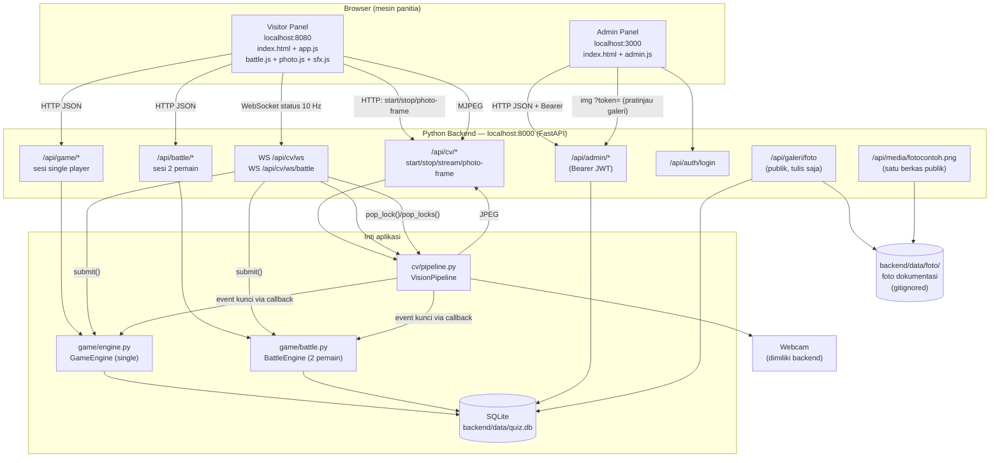
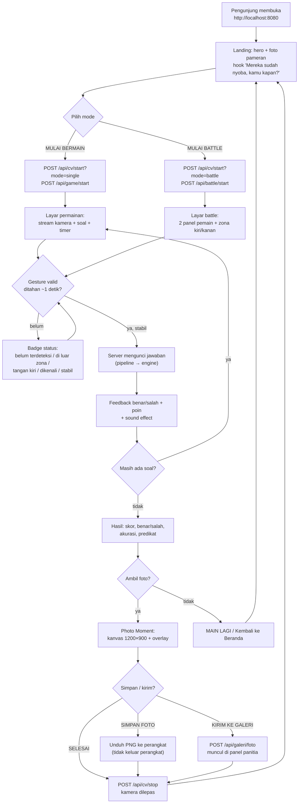

# Arsitektur SKOMDA Gesture Quiz

Dokumen teknis untuk tim SKOMDA Gesture Quiz — SMK Telkom Sidoarjo.
Disusun dari **kode yang benar-benar ada di repository** (bukan dari dokumen
spesifikasi). Setiap bagian menyebut berkas sumbernya, sehingga klaim bisa
diverifikasi langsung.

Versi kode saat dokumen ini ditulis: `app.__version__ = "1.0.0"`,
Python 3.11.4, `mediapipe==1.2.2`, `opencv-python==5.0.0.93`,
`fastapi==0.162.4`, 204 test lulus (lihat §K).

Penanda yang dipakai di seluruh dokumen:

| Penanda | Arti |
|---|---|
| **ADA** | fitur ditemukan di kode dan berjalan |
| **ADA, TERBATAS** | ada, tetapi cakupannya lebih sempit dari yang mungkin diduga |
| **BELUM DIIMPLEMENTASIKAN** | tidak ditemukan di kode sama sekali |

---

## A. Identitas Proyek

**Nama**: SKOMDA Gesture Quiz — kuis interaktif berbasis *computer vision*
untuk pameran teknologi SMK Telkom Sidoarjo. "SKOMDA" adalah sebutan sekolah;
kode internal memakai prefiks `skomda` (mis. `SKOMDA_DB`, `window.skomdaSfx`).

**Tujuan aplikasi**
1. Menjadi atraksi *booth* pameran: pengunjung menjawab pertanyaan pilihan
   ganda dengan **gerakan jari**, bukan keyboard atau layar sentuh.
2. Menjadi alat peraga yang memperlihatkan teknologi computer vision secara
   nyata kepada pengunjung SMP/SMK.
3. Menjadi karya yang bisa dipertanggungjawabkan secara teknis di depan juri
   (arsitektur, pengujian, keamanan, keterbatasan).

**Latar belakang penggunaan Computer Vision**
Kuis konvensional memerlukan sentuhan (layar/HP) yang membuat antrean lambat
dan alat cepat kotor di pameran. Kamera + *hand landmark detection* memberi
interaksi tanpa sentuhan, tanpa perangkat tambahan, dan tanpa instalasi di
sisi pengunjung — cukup berdiri di depan kamera.

**Permasalahan yang diselesaikan**
1. Interaksi tanpa sentuhan pada kios pameran (higienis, cepat, menarik).
2. Jawaban harus **valid dan tidak bisa dipalsukan** lewat browser →
   seluruh keputusan jawaban dibuat di server (lihat §C dan §J).
3. Deteksi tangan yang **tidak stabil** (jitter antar frame) → stabilisasi
   temporal 1 detik sebelum jawaban dikunci.
4. Kondisi pameran **ramai**: banyak orang di belakang pemain, tangan orang
   lain ikut terdeteksi → seleksi tangan berdasarkan area, ukuran, dan
   identitas antar frame (lihat §D).
5. Sesi yang ditinggal pengunjung tidak boleh menggantung di database →
   *timer* ditegakkan di server + sesi telantar ditutup otomatis.
6. Nama file foto pengunjung tidak boleh dipakai untuk menebak/menulis ke
   filesystem → nama file dibuat server-side, format diperiksa dari *magic
   bytes*.

**Manfaat untuk kegiatan pameran SMK Telkom Sidoarjo**
- Menunjukkan kompetensi siswa (Python, OpenCV, MediaPipe, FastAPI, SQLite,
  frontend) dalam satu produk yang bisa dicoba publik.
- Menyediakan *booth* interaktif yang menghasilkan dokumentasi foto
  (Photo Moment) untuk publikasi sekolah.
- Menyediakan panel panitia untuk mengelola soal dan melihat statistik
  pemakaian selama pameran.
- Menjadi basis belajar: kode dipisah menjadi modul yang bisa diuji tanpa
  kamera (204 test).

---

## B. Teknologi yang Digunakan

Hanya yang benar-benar dipakai (diverifikasi lewat `import` di kode dan
`requirements.txt`).

| Teknologi | Versi (dipin) | Dipakai di | Fungsi nyata |
|---|---|---|---|
| Python | 3.11.4 (venv proyek) | seluruh backend & scripts | bahasa utama |
| FastAPI | 0.162.4 | `app/main.py`, `app/routers/*` | HTTP + WebSocket API |
| Uvicorn | 0.54.0 | `app/__main__.py`, `scripts/run_all.py` | ASGI server |
| Starlette | 1.10.0 | di bawah FastAPI | routing, `StreamingResponse`, `StaticFiles` tidak dipakai (server statis sendiri) |
| Pydantic | 2.14.3 | `app/schemas.py` | validasi request/response |
| python-multipart | 0.0.33 | `routers/galeri.py` | parsing upload form-data |
| MediaPipe | 1.2.2 | `app/cv/landmarks.py` | Hand Landmarker 21 titik (`tasks.python.vision`) |
| OpenCV (`opencv-python`) | 5.0.0.93 | `app/cv/camera.py`, `overlay.py`, `pipeline.py` | buka webcam, gambar overlay, encode JPEG/MJPEG |
| NumPy | 2.4.6 | `app/cv/gesture.py`, `players.py`, `tracking.py`, `scripts/generate_sfx.py` | geometri jari, tracker, sintesis audio |
| SQLite (`sqlite3`) | bawaan Python | `app/database.py`, `app/galeri.py` | penyimpanan soal, sesi, jawaban, galeri |
| PyJWT | 2.15.1 | `app/security.py` | token admin HS256 |
| bcrypt | 5.0.0 | `app/security.py` | hash password |
| pytest + httpx | 9.2.0 / 0.28.1 | `tests/` | pengujian tanpa kamera |
| HTML + CSS + JavaScript (vanilla) | — | `frontend/admin`, `frontend/visitor` | dua panel statis, tanpa framework/build step |
| REST API (JSON) | — | `/api/game/*`, `/api/battle/*`, `/api/admin/*`, dst. | kontrak antarmuka |
| WebSocket | — | `/api/cv/ws`, `/api/cv/ws/battle` | status live + event kunci jawaban |
| MJPEG (`multipart/x-mixed-replace`) | — | `GET /api/cv/stream` | menampilkan kamera di `` |
| Web Audio API | browser | `frontend/visitor/assets/js/sfx.js` | sound effect lokal (12 WAV) |
| Rule-Based Gesture Classification | — | `app/cv/gesture.py` | klasifikasi A/B/C/D per jari (bukan ML classifier terlatih) |

**Catatan penting**: klasifikasi gesture **BUKAN** model machine learning
terlatih sendiri. Yang dipakai adalah model *hand landmark* MediaPipe (model
siap pakai) + **aturan geometri** buatan tim untuk menentukan A/B/C/D.
Tidak ada TensorFlow, PyTorch, YOLO, person detection, atau database
eksternal di repository ini.

**Yang sengaja TIDAK dipakai** (agar tidak salah sebut saat presentasi):
tidak ada Node.js/npm, tidak ada React/Vue, tidak ada Docker, tidak ada
PostgreSQL/MySQL, tidak ada Redis, tidak ada cloud storage, tidak ada layanan
eksternal untuk gambar/video. Frontend dilayani `http.server` dari Python
standar (`scripts/serve_frontend.py`).

---

## C. Arsitektur Sistem

Tiga service terpisah, semuanya berjalan di mesin yang sama (laptop/PC
panitia):

| Service | Port | Kode | Peran |
|---|---|---|---|
| **Python Backend/API** | 8000 | `backend/app/` | pemilik kamera, seluruh logika CV & permainan, database, auth |
| **Visitor Panel** | 8080 | `frontend/visitor/` | halaman pengunjung: landing, permainan, battle, photo moment |
| **Admin Panel** | 3000 | `frontend/admin/` | panel panitia: soal, pengaturan, sesi, galeri foto |

Orkestrasi satu perintah: `scripts/run_all.py` (dipanggil `start.bat`).
Jika port sibuk, `serve_frontend.py` memilih port berikutnya dan mencetak URL
sebenarnya (3001, 8081, …). Backend dilindungi CORS untuk loopback.

### Diagram arsitektur



### Fungsi & komunikasi antarkomponen

1. **Backend pemilik kamera.** Browser **tidak pernah mengirim frame**.
   `POST /api/cv/start?mode=single|battle` membuka webcam; browser hanya
   menampilkan `GET /api/cv/stream` (MJPEG) — stream bersifat *display-only*.
   Konsekuensi: pengunjung tidak bisa memalsukan gesture dari DevTools.
2. **Keputusan jawaban di server.** Event kunci gesture diproduksi
   `VisionPipeline` (thread vision) dan diteruskan langsung ke game engine
   lewat callback, bukan menunggu browser. WebSocket hanya **menampilkan**
   hasil (`jawaban`, `game_event`).
3. **Single vs battle terpisah**. `GameEngine` (single) dan `BattleEngine`
   (dua pemain) adalah objek berbeda, dengan router berbeda
   (`/api/game/*` vs `/api/battle/*`) dan endpoint WebSocket berbeda
   (`/ws` vs `/ws/battle`). Mode battle tidak pernah menyentuh state single.
4. **Static server terpisah** (`scripts/serve_frontend.py`) menyajikan dua
   folder frontend, menyediakan `/config.js` (`window.SKOMDA_API`), dan
   memetakan `/assets/foto/<nama>` ke `backend/data/foto/` **tanpa menyalin**
   berkas. Path traversal ditolak (`Path.relative_to`).
5. **Pemisahan tanggung jawab**: pipeline CV tidak tahu soal kuis/skor;
   engine tidak tahu kamera. Satu-satunya kopling adalah callback kunci.

---

## D. Arsitektur Computer Vision

### Alur pemrosesan

```
Webcam → OpenCV (capture thread) → Frame Processing → MediaPipe Hand Landmarker
      → 21 Hand Landmarks → Gerbang kualitas + Tracking → Gesture Classification
      → Temporal Stabilization (+ cooldown, re-arm) → Game Engine
```

Berkas: `cv/camera.py` → `cv/landmarks.py` → `cv/tracking.py` →
`cv/gesture.py` → `cv/stabilizer.py` → `cv/pipeline.py` → `game/`.

### Fungsi tiap komponen

**OpenCV (`cv/camera.py`)** — membuka webcam (`cv2.VideoCapture`, di Windows
mencoba `CAP_DSHOW` lalu backend default), menyetel resolusi/FPS/buffer=1,
dan menjalankan **thread capture** yang menyimpan *hanya frame terbaru* +
`frame_id` naik. Pipeline tidak pernah membaca kamera langsung, sehingga
pemrosesan lambat **menjatuhkan frame** (drop), bukan menumpuk antrean.
Kamera dilepas di `stop()` (endpoint `/api/cv/stop`, shutdown `lifespan`,
dan `pagehide` beacon dari browser).

**MediaPipe (`cv/landmarks.py`)** — `mediapipe.tasks.python.vision.HandLandmarker`
dengan `RunningMode.VIDEO` dan model `backend/models/hand_landmarker.task`.
`mediapipe 1.2.2` tidak lagi punya `mp.solutions.hands`, jadi API Tasks yang
dipakai. `detect_for_video` menuntut timestamp naik → dijaga
`ts = max(ts, _last_ts + 1)`.

**21 Hand Landmarks** — keluaran MediaPipe: 0 pergelangan; 1–4 ibu jari;
5–8 telunjuk; 9–12 tengah; 13–16 manis; 17–20 kelingking. Koordinat
ternormalisasi 0..1 (`x`, `y`, `z`). Dipetakan ke `HAND_CONNECTIONS` di
`landmarks.py` untuk overlay.

**Identifikasi tangan kanan (handedness)** — frame **di-mirror**
(`cv2.flip(frame, 1)`) sebelum inferensi agar tampilan terasa seperti cermin.
Karena MediaPipe melabeli berdasarkan gambar apa adanya, label pada frame
mirror **terbalik**: tangan kanan nyata dilaporkan `"Left"`. Karena itu ada
`real_handedness()` yang membalik label **sekali** di modul landmark, supaya
seluruh sistem (classifier, overlay, WebSocket, UI) berbicara tentang tangan
yang sebenarnya. Aturan penolakan: `require_right and handedness == "Left"`
→ gesture tidak valid dengan alasan "Itu tangan kiri". Label `"Unknown"`
(tangan miring) tetap diterima agar pengunjung tidak terkunci.

**Rule-Based Classification (`cv/gesture.py`)** — bukan menghitung jumlah
jari. Setiap jari dievaluasi individual dengan dua ukuran yang invarian
terhadap jarak & rotasi:
1. *Rasio panjang* `|tip − wrist| / |pip − wrist|` (jari terlipat → tip
   mendekati pergelangan).
2. *Kelurusan* cos sudut `(pip − mcp)` vs `(tip − pip)`.

Keduanya dibandingkan dengan ambang per jari (telunjuk/tengah 1.22, manis
1.18, kelingking 1.14; lurus ≥ 0.55). Skala acuan adalah **lebar telapak**
`|MCP telunjuk − MCP kelingking|`, jadi tidak bergantung ukuran tangan di
frame. Ibu jari punya aturan sendiri: dianggap **terlipat** bila abduksi
`|tip ibu jari − pusat telapak| / lebar telapak ≤ 0.72`.

**Gesture A, B, C, D** — kombinasi boolean empat jari dicocokkan ke himpunan
sah (urutan dari telunjuk ke kelingking):

| Gesture | (telunjuk, tengah, manis, kelingking) | Aturan |
|---|---|---|
| A | (True, False, False, False) | telunjuk terangkat |
| B | (True, True, False, False) | telunjuk + tengah |
| C | (True, True, True, False) | telunjuk + tengah + manis |
| D | (True, True, True, True) | empat jari terbuka |

Kombinasi lain (mis. telunjuk + manis, atau tanpa telunjuk) **tidak valid**
dan diberi alasan spesifik yang ditampilkan ke pengunjung
("Jari harus berurutan dari telunjuk", "Lipat ibu jari", dst.). Ibu jari
harus terlipat pada semua gesture.

**Temporal Smoothing (`cv/stabilizer.py`)** — jendela 0.6 detik; gesture
dianggap kandidat bila ≥ 60% sampel di jendela sepakat. Kandidat harus
ditahan `hold_seconds` (default 1.0 s, bisa diubah panitia 0.6–3.0) sebelum
**mengunci**. Jitter antar frame tidak menghasilkan kunci; satu frame hilang
tidak membatalkan progres.

**Cooldown & re-arm** — setelah kunci: `armed = False` sehingga tombol
"jawab" tidak bisa terpicu dua kali, dan tangan **wajib dilepas** (netral
≥ `rearm_seconds` = 0.25 s) sebelum gesture berikutnya bisa mengunci.
Tambahan: saat soal baru muncul, WebSocket battle memanggil
`disarm_stabilizers()`. Tangan yang masih terangkat tidak otomatis menjawab
soal berikutnya.

**Deteksi dua pemain & pemisahan zona** — dua lapis:
1. `cv/players.py::PlayerSplitter` — stateless, memisahkan satu frame
   berdasarkan posisi horizontal telapak (`palm_x`), bukan urutan hasil
   MediaPipe. Kiri → Player 1, kanan → Player 2, batas `x = 0.5`, jarak
   minimum antar pemain 0.10 (mencegah satu tangan dipakai dua pemain).
2. `cv/players.py::PlayerTracker` — **stateful**, dipakai pipeline. Slot
   pemain ditambatkan ke **ID track**, bukan posisi mentah:
   - pemilik slot mempertahankan slot walau tangannya bergeser zona (zona
     menjadi peringatan, **bukan** alasan menukar identitas);
   - tangan hilang < `PLAYER_MEMORY_SECONDS` (0.9 s) → slot ditahan
     (status `memori`), tidak direbut orang lain;
   - tangan baru hanya mengisi slot yang benar-benar kosong, menurut zona
     kemunculannya; tangan ekstra → `unassigned` (tidak bisa menjawab).

### Seleksi tangan di keramaian pameran (peningkatan terbaru)

Masalah: MediaPipe mengembalikan semua tangan yang terlihat, termasuk tangan
pengunjung lain di belakang pemain. Solusi berlapis di `cv/tracking.py` dan
`cv/pipeline.py`:

| Lapis | Mekanisme | Parameter (env) |
|---|---|---|
| 1. Ambang keyakinan | `min_hand_detection_confidence`, `min_hand_presence_confidence`, `min_tracking_confidence` | `SKOMDA_HAND_DET_CONF=0.60`, `_PRESENCE_CONF=0.60`, `_TRACK_CONF=0.55` |
| 2. Jumlah kandidat | mode single meminta **3** kandidat (bukan 1), battle **4** — agar tangan latar bisa dilihat lalu **ditolak**, bukan menjadi satu-satunya hasil | `SKOMDA_MAX_HANDS_SINGLE=3`, `_BATTLE=4` |
| 3. ROI (area permainan) | pusat tangan harus di dalam `x0,y0,x1,y1` (default membuang strip atas frame) | `SKOMDA_HAND_ROI=0.02,0.05,0.98,1.0` |
| 4. Ukuran tangan | lebar telapak minimum → tangan jauh di latar belakang ditolak | `SKOMDA_HAND_MIN_PALM=0.055` |
| 5. Tracking antar frame | ID stabil via IoU + jarak pusat; batas rasio ukuran (0.6–1.6×) mencegah tangan jauh mewarisi ID pemain | `SKOMDA_TRACK_MAX_MISS=0.8`, `SKOMDA_TRACK_DIST=0.30` |
| 6. Pemilihan tangan utama (single) | tangan **terbesar** = paling dekat kamera; identitasnya dipertahankan sehingga sistem tidak berpindah ke tangan orang lain saat pemain hilang sesaat | — |
| 7. Memori pemain (battle) | slot pemain ditahan 0.9 s saat tangan hilang | `SKOMDA_PLAYER_MEMORY=0.9` |

Setiap penolakan **dicatat sebagai alasan** (`terlalu_kecil`, `luar_area`,
`skor_rendah`) dan dikirim ke UI (`tangan_ditolak`, `tangan_mentah`,
`tangan_terlihat`) supaya pengunjung mendapat pesan yang bisa ditindaklanjuti
("maju mendekat"), bukan sekadar "tidak terdeteksi".

### Indikator status (panduan posisi pemain)

`VisionPipeline._kode_status()` menghasilkan satu kode per pemain:

| Kode | Arti | Tampilan |
|---|---|---|
| `tidak_ada` | belum ada tangan sah | badge "BELUM TERDETEKSI" (kuning) |
| `memori` | tangan hilang sesaat, slot ditahan | "HILANG SESAAT" |
| `zona_salah` | tangan di zona pemain lain | "DI LUAR ZONA — geser" |
| `tangan_kiri` | tangan kiri terdeteksi | "TANGAN KIRI — pakai kanan" |
| `belum_valid` | bentuk jari belum A/B/C/D | alasan spesifik dari classifier |
| `mengenali` | gesture dikenali, belum stabil | "DIKENALI" (hijau) |
| `menahan` | progres tahan berjalan | "STABIL" + meter progres |
| `terkunci` | jawaban terkunci | "TERKUNCI" (merah/biru) |

### Keterbatasan yang harus jujur disampaikan

- **Sistem tidak dapat mengabaikan seluruh tangan latar belakang secara
  sempurna.** Yang dilakukan adalah penyaringan berlapis (ROI, ukuran,
  tracking, keyakinan). Bila MediaPipe tetap mendeteksi banyak tangan di
  area yang sama, gangguan masih mungkin terjadi.
- **Tidak ada person detection.** Tidak ada model tubuh/orang di repository
  ini, sehingga sistem tidak tahu siapa "pemain" secara semantik — hanya
  memakai geometri. Pengembangan berikutnya: person detection
  (mis. MediaPipe Pose / YOLO) atau depth camera.
- **Akurasi belum diukur dengan metrik formal.** Belum ada dataset
  berlabel/tabel akurasi per kondisi cahaya. Yang ada: 204 test sintetis +
  skrip kalibrasi manual (`tests/record_gesture_samples.py`,
  `scripts/analyze_calibration.py`) dan pemeriksaan kamera manual
  (`tests/manual_camera_check.py`, `manual_battle_check.py`,
  `live_check_battle.py`). **Jangan mengklaim angka akurasi sebelum diukur
  dengan tangan nyata di lokasi pameran.**

---

## E. Arsitektur Game Engine

Berkas: `game/engine.py` (single), `game/battle.py` (2 pemain),
`routers/game.py`, `routers/battle.py`.

### Single Player — **ADA**
`GameEngine` menyimpan **satu sesi aktif** (kios: satu kamera, satu
pengunjung). `start()` mengambil soal acak dari DB
(`ORDER BY RANDOM() LIMIT jumlah_soal`, hanya `aktif = 1`), lalu
`public_state()` mengirim state **tanpa kunci jawaban**.

### 2 Player Battle — **ADA**
`BattleEngine` menyimpan satu pertandingan aktif dengan dua objek
`PemainBattle` terpisah (skor, benar, jawaban, riwayat sendiri). Soal sama,
skor terpisah. Soal hanya berganti bila **kedua** pemain menjawab atau waktu
habis; pemain yang sudah menjawab tetap mempertahankan jawabannya.

### Sistem pertanyaan — **ADA**
Tabel `pertanyaan` (lihat §F). Field: teks, empat pilihan, kunci jawaban,
kategori, durasi per soal, status aktif. Dikelola dari Admin Panel
(CRUD). Jawaban tidak pernah dikirim ke browser sebelum soal selesai.

### Timer — **ADA (server-side)**
- Waktu mulai soal diambil `time.monotonic()` di server.
- `submit()` menolak jawaban yang datang setelah `durasi` habis (dicatat
  sebagai timeout), jadi browser tidak bisa mengakali timer.
- `tick()` dijalankan worker `lifespan` setiap 1 detik **dan** dipanggil
  dari endpoint state/WebSocket, sehingga sesi tetap maju meski tab ditutup.
- `next_question()` idempoten: hanya maju bila soal aktif sudah punya
  jawaban tercatat — mencegah soal terlewat saat worker dan browser
  memanggil bersamaan.
- Sesi ditinggal > `SKOMDA_ABANDON_AFTER` (120 s) → ditutup sebagai
  `dibatalkan` (tidak ada sesi "berjalan" menggantung).
- Browser punya timer sendiri **hanya untuk tampilan**; sumber kebenaran
  tetap server (ada sinkronisasi bila selisih > 1.5 s).

### Perhitungan skor — **ADA**
Satu rumus dipakai kedua mode (`engine.hitung_poin`):
`poin = POIN_BENAR(10) + round(5 × (1 − waktu_pakai/durasi))` bila benar;
0 bila salah/timeout. Jadi maksimum 15 poin per soal, menurun linear
terhadap waktu. Skor disimpan ke DB setiap perubahan (battle) sehingga
tidak hilang bila server mati di tengah pertandingan.

### Penentuan pemenang — **ADA**
`BattleEngine.result()`: `pemenang = 1|2|None`; `seri = True` bila skor
sama. UI menampilkan nama pemenang + poin, atau "SERI".

### Photo Moment — **ADA**
Setelah permainan: `GET /api/cv/photo-frame` mengirim **frame terakhir tanpa
overlay** (kualitas 92). Browser menyusun foto di `<canvas>` 1200×900
(overlay SKOMDA, identitas sekolah, skor) lalu:
- **SIMPAN FOTO** → unduhan PNG lokal (`toDataURL`), tidak keluar perangkat;
- **KIRIM KE GALERI PANITIA** → tombol eksplisit, mengirim PNG ke
  `POST /api/galeri/foto` (lihat §F/§J).
Tidak ada foto yang dikirim ke layanan eksternal; backend tidak pernah
mengambil foto sendiri (hanya menyediakan frame saat diminta).

### Leaderboard — **BELUM DIIMPLEMENTASIKAN**
Tidak ada endpoint maupun UI peringkat/hall of fame. Yang tersedia hanya
riwayat dan agregat untuk panitia:
- `GET /api/admin/sesi` (riwayat sesi, `limit` 1–100)
- `GET /api/admin/stats` (jumlah soal, total sesi selesai, rata-rata skor,
  total jawaban, akurasi)
Skor tidak dipakai untuk membandingkan pengunjung satu sama lain.

---

## F. Database

**SQLite** (modul `sqlite3` standar, tanpa ORM), berkas
`backend/data/quiz.db` (bisa diubah via `SKOMDA_DB`). Setiap operasi memakai
koneksi sendiri (`timeout=15`, `PRAGMA foreign_keys = ON`) karena backend
diakses dari thread kamera + thread request. Skema di `database.py::SCHEMA`;
migrasi kolom idempoten `_migrasi_kolom()` jalan setiap startup.

### Tabel yang benar-benar ada (6 tabel)

**1. `admin`** — akun panitia
`id` INTEGER PK AUTOINCREMENT · `username` TEXT UNIQUE · `password_hash`
TEXT (bcrypt) · `nama` TEXT · `created_at` TEXT

**2. `pertanyaan`** — bank soal
`id` PK · `pertanyaan` · `pilihan_a` · `pilihan_b` · `pilihan_c` ·
`pilihan_d` · `jawaban` CHECK IN ('A','B','C','D') · `kategori` (default
'Umum') · `durasi` INTEGER (default 30) · `aktif` INTEGER (default 1) ·
`created_at` · `updated_at`
Indeks: `idx_pertanyaan_kategori(kategori)`

**3. `sesi_permainan`** — satu baris per sesi (single maupun battle)
`id` TEXT PK (uuid hex 12) · `total_soal` · `benar` · `skor` · `status`
(`berjalan`|`selesai`|`dibatalkan`) · `started_at` · `finished_at` ·
`mode` ('single'|'battle') · `pemain_1` · `pemain_2` · `skor_1` · `skor_2` ·
`benar_1` · `benar_2`
Kolom battle dibuat `NULL`-able agar baris single tetap valid.

**4. `jawaban_permainan`** — satu baris per jawaban (termasuk timeout)
`id` PK · `sesi_id` **FK** → `sesi_permainan(id)` `ON DELETE CASCADE` ·
`pertanyaan_id` INTEGER (bukan FK ketat; di-`NULL`-kan saat soal dihapus) ·
`urutan` · `jawaban` (NULL = timeout) · `benar` · `waktu_pakai` REAL ·
`created_at` · `pemain` (NULL = single, 1/2 = battle)
Indeks: `idx_jawaban_sesi(sesi_id)`

**5. `pengaturan`** — key/value pengaturan panitia
`kunci` TEXT PK · `nilai` TEXT · `updated_at`
Default/batas (ditegakkan di backend): `jumlah_soal` 5 (1–20),
`durasi_default` 30 (5–180), `hold_detik` 1.0 (0.6–3.0),
`cooldown_detik` 1.5 (0.5–5.0).

**6. `galeri_foto`** — metadata foto yang dikirim pengunjung
`id` PK · `nama_file` TEXT UNIQUE · `sesi_id` · `mode` · `pemain_1` ·
`pemain_2` · `skor_1` · `skor_2` · `pemenang` · `ukuran` · `created_at`
Indeks: `idx_galeri_created(created_at DESC)`

### Relasi

Satu-satunya *foreign key* yang ditegakkan SQLite:
`jawaban_permainan.sesi_id → sesi_permainan.id` (ON DELETE CASCADE).
`jawaban_permainan.pertanyaan_id` sengaja tanpa FK ketat agar soal bisa
dihapus tanpa menghapus riwayat (nilai di-`NULL`-kan saat `DELETE
/api/admin/pertanyaan/{id}`). `galeri_foto.sesi_id` hanya informasi (tidak
ada FK).

### Data yang disimpan

Soal & kunci jawaban; sesi (mode, skor, status, waktu); setiap jawaban
(pilihan, benar/salah, waktu pakai, pemain); pengaturan permainan; metadata
foto (nama file, ukuran, sesi terkait). **Tidak ada** data pribadi
pengunjung: tidak ada nama pengunjung, tidak ada email, tidak ada nomor
telepon, tidak ada rekaman video.

### Mekanisme penyimpanan foto

File PNG/JPEG di `config.FOTO_DIR` (default `backend/data/foto/`,
di-`.gitignore`), metadata di `galeri_foto`.
- Nama file dibuat server-side: `YYYYmmdd-HHMMSS-<8 hex>.<ext>`
  (nama dari klien **tidak dipercaya**).
- Format ditentukan dari **magic bytes** (PNG `89 50 4E 47`, JPEG `FF D8 FF`),
  bukan ekstensi.
- Batas: `FOTO_MAX_BYTES` (8 MB), dimensi ≤ 4000 px, maksimum 500 foto
  (terlama dipangkas otomatis: file + baris DB).
- Tulis ke `.part` lalu `rename` → foto setengah jadi tidak pernah tampil.
- Thumbnail ~520 px JPEG dibuat di `foto/thumb/` saat diminta (galeri 60
  kartu tidak menarik puluhan MB).
- Foto hero landing (`fotocontoh.png`) disajikan lewat
  `/api/media/fotocontoh.png` (satu nama dipatok, tidak bisa dipakai
  membaca foto galeri) dan `/assets/foto/…` dari static server.

---

## G. Admin Panel

Berkas: `frontend/admin/index.html`, `assets/js/admin.js`, `assets/css/*`,
dilayani `localhost:3000`. Semua endpoint di bawah `/api/admin/*` wajib
`Authorization: Bearer <JWT>` (dependency `require_admin`).

### Fitur yang ADA

| Fitur | Endpoint | Catatan |
|---|---|---|
| Login admin | `POST /api/auth/login` | JWT HS256, TTL 8 jam, throttle 5 percobaan/5 menit per IP |
| Info sesi login | `GET /api/auth/me` | verifikasi token aktif |
| Dashboard statistik | `GET /api/admin/stats` | total/aktif soal, kategori, sesi selesai, rata-rata skor, total jawaban, akurasi, 5 soal terbaru |
| CRUD soal | `GET/POST /api/admin/pertanyaan`, `GET/PUT/DELETE /api/admin/pertanyaan/{id}` | filter kategori, pencarian, paginasi (`limit`/`offset`) |
| Daftar kategori | `GET /api/admin/kategori` | untuk dropdown |
| Riwayat sesi | `GET /api/admin/sesi?limit=` | 20 terakhir secara default |
| Pengaturan permainan | `GET/PUT /api/admin/pengaturan` | batas min/max dikirim API agar form tidak menduplikasi angka |
| Ganti password | `POST /api/admin/password` | wajib password lama, minimal 8 karakter, token lama tidak dipaksa logout |
| Galeri foto | `GET /api/admin/galeri`, `GET /api/admin/galeri/{nama_file}?thumb=1`, `DELETE /api/admin/galeri/{id}` | pratinjau `` memakai `?token=` karena tag `` tidak bisa mengirim header |

### Autentikasi (aktual)

Password disimpan sebagai bcrypt cost 12 atas prehash SHA-256 (bcrypt
membatasi 72 byte). Username + password → JWT `{sub, role:"admin", iat,
exp}` ditandatangani secret HS256 dari `SKOMDA_SECRET` atau berkas
`backend/data/.jwt_secret` (dibuat acak 48 byte saat pertama jalan,
`chmod 600` bila memungkinkan).

Akun awal di-seed saat DB kosong: `admin` / `skomda2026`
(`SKOMDA_ADMIN_USER`/`SKOMDA_ADMIN_PASS`), dan password default itu
**dicetak di halaman login**. Rotasi tersedia (§G tabel), tetapi
**password default tetap harus diganti sebelum pameran**.

### Dashboard & galeri

Dashboard: kartu statistik + daftar soal terbaru. Galeri: grid thumbnail
(`?thumb=1`), filter mode (single/battle), unduh, hapus. Belum ada:
ekspor CSV/Excel, grafik tren waktu, atau manajemen pengguna lebih dari
satu akun (**ADA, TERBATAS**: satu tabel admin, tanpa UI tambah admin).

---

## H. Alur Pengunjung



Catatan alur:
- Kamera **tidak** menyala saat backend start. Baru menyala ketika
  pengunjung menekan MULAI (atau saat Photo Moment dibuka).
- Sound effect baru aktif setelah klik MULAI (tidak ada autoplay).
- Bila kamera gagal, permainan tetap bisa dicoba lewat jalur manual
  (`Kamera bermasalah? Jawab dengan klik`) — dapat dimatikan panitia dengan
  `SKOMDA_ALLOW_MANUAL_ANSWER=0` untuk pameran murni gesture.

---

## I. Struktur Folder

```
kelompok1dtp/
├── start.bat                     # launcher Windows: cek venv/model/kamera lalu run_all
├── stop.bat                      # hentikan service per-port (melepas kamera)
├── requirements.txt              # dependency dipin + komentar modul pemakainya
├── README.md                     # panduan teknis umum
├── CARA-RUN.md                   # panduan menjalankan (fokus operasional)
├── conftest.py                   # sys.path untuk pytest
├── docs/
│   └── ARSITEKTUR_SKOMDA_GESTURE_QUIZ.md   # dokumen ini
├── backend/
│   ├── app/
│   │   ├── __init__.py           # __version__
│   │   ├── __main__.py           # entrypoint `python -m app` (uvicorn)
│   │   ├── main.py               # FastAPI app, CORS, lifespan (worker timer), /health, /info
│   │   ├── config.py             # semua env & path terpusat
│   │   ├── database.py           # skema SQLite, migrasi idempoten, seed, pengaturan
│   │   ├── security.py           # bcrypt, JWT, require_admin(_media), throttle login
│   │   ├── schemas.py            # model Pydantic request
│   │   ├── galeri.py             # simpan/daftar/ambil/hapus foto + thumbnail + prune
│   │   ├── cv/                   # ---- computer vision ----
│   │   │   ├── camera.py         # capture thread, frame terbaru menang, release
│   │   │   ├── landmarks.py      # MediaPipe HandLandmarker (21 titik) + koreksi handedness
│   │   │   ├── gesture.py        # klasifikasi A/B/C/D rule-based per jari
│   │   │   ├── stabilizer.py     # hold/cooldown/re-arm (clock disuntik)
│   │   │   ├── tracking.py       # HandFilter (ROI+ukuran) & HandTracker (ID stabil)
│   │   │   ├── players.py        # PlayerSplitter (stateless) & PlayerTracker (stateful)
│   │   │   ├── overlay.py        # HUD OpenCV: landmark, zona, status, progres
│   │   │   └── pipeline.py       # perakit: kamera→deteksi→filter→track→klasifikasi→stabilisasi→JPEG
│   │   ├── game/
│   │   │   ├── engine.py         # GameEngine single + hitung_poin (dipakai kedua mode)
│   │   │   └── battle.py         # BattleEngine 2 pemain (skor & state terpisah)
│   │   └── routers/
│   │       ├── auth.py           # /api/auth/login, /me
│   │       ├── admin.py          # /api/admin/* (Bearer) + media_router (?token=)
│   │       ├── game.py           # /api/game/*  (single)
│   │       ├── battle.py         # /api/battle/* (2 pemain)
│   │       ├── cv.py             # /api/cv/* + WS /ws, /ws/battle
│   │       ├── galeri.py         # /api/galeri/foto (publik, tulis saja)
│   │       └── media.py          # /api/media/fotocontoh.png (satu berkas publik)
│   ├── data/                     # runtime, TIDAK di-commit isinya
│   │   ├── quiz.db               # SQLite
│   │   ├── .jwt_secret           # secret JWT per instalasi
│   │   ├── foto/                 # foto dokumentasi + thumb/ (gitignored)
│   │   └── calibration/          # sampel landmark JSONL (gitignored)
│   └── models/
│       └── hand_landmarker.task  # model MediaPipe (±7,5 MB, ikut commit)
├── frontend/
│   ├── visitor/                  # ---- Panel pengunjung (8080) ----
│   │   ├── index.html            # semua layar: landing, game, result, battle, photo
│   │   └── assets/
│   │       ├── css/main.css      # token warna + hero + kontrol audio + responsif
│   │       ├── css/multiplayer.css # mode picker, battle HUD, photo, result battle
│   │       ├── js/app.js         # single player: start, timer, WS, feedback, manual
│   │       ├── js/battle.js      # 2 pemain: skor, panel, badge status, hasil
│   │       ├── js/photo.js       # Photo Moment: kanvas, unduh, kirim galeri
│   │       ├── js/sfx.js         # audio lokal: unlock, mute, volume, anti-tumpuk
│   │       ├── audio/*.wav       # 12 sound effect (dihasilkan generate_sfx.py)
│   │       └── img/logo-sekolah.png
│   └── admin/                    # ---- Panel panitia (3000) ----
│       ├── index.html
│       └── assets/{css,js,img}/
├── scripts/
│   ├── run_all.py                # orkestrator 3 service (backend+admin+visitor)
│   ├── serve_frontend.py         # static server + /config.js + mapping /assets/foto
│   ├── download_model.py         # unduh model MediaPipe bila hilang
│   ├── generate_sfx.py           # generator 12 WAV (numpy + wave)
│   ├── analyze_calibration.py    # analisis distribusi ambang dari sampel landmark
│   └── bersihkan_sesi.py         # tutup sesi "berjalan" yang menggantung
└── tests/
    ├── conftest.py / synthetic_hand.py   # generator 21 landmark sintetis
    ├── test_api.py                # endpoint publik & admin
    ├── test_battle.py             # engine battle + pemisahan zona
    ├── test_pipeline_battle.py    # pipeline battle dengan kamera & detector palsu
    ├── test_hand_selection.py     # ROI, ukuran, tracker, identitas pemain
    ├── test_gesture.py            # geometri gesture A/B/C/D
    ├── test_galeri.py             # validasi upload & akses media
    ├── test_pengaturan.py         # pengaturan + batas
    ├── test_waktu_server.py       # timer server-side & abandonment
    ├── test_jawab_manual.py       # jalur jawaban manual
    ├── record_gesture_samples.py  # rekam sampel landmark berlabel (kalibrasi)
    ├── manual_camera_check.py     # uji kamera nyata (satu tangan)
    ├── manual_battle_check.py     # uji kamera nyata (dua pemain)
    └── live_check_battle.py       # uji end-to-end battle
```

---

## J. Keamanan dan Privasi

### Sudah diterapkan

| Aspek | Implementasi (berkas) |
|---|---|
| **Password hashing** | bcrypt cost 12 atas SHA-256 prehash (`security.py`). Tidak ada plaintext di DB. |
| **Autentikasi** | JWT HS256, TTL 8 jam, `role: "admin"` (`security.py::create_token`). Secret acak per instalasi di `backend/data/.jwt_secret`; bisa di-override `SKOMDA_SECRET`. |
| **Throttle login** | Maksimum 5 percobaan / 5 menit per IP, in-memory (`LoginThrottle`) → 429. |
| **Otorisasi endpoint** | Seluruh `/api/admin/*` memakai dependency `require_admin` di level router. Media galeri memakai `require_admin_media` yang juga menerima `?token=` (verifikasi decoder yang sama). Visitor tidak punya token → 401. |
| **CORS** | Hanya origin loopback (`config.CORS_ORIGINS`) + regex `^http://(localhost\|127\.0\.0\.1)(:\d+)?$` untuk port bergeser. `allow_credentials=False`. |
| **Pemrosesan webcam** | Frame **tidak pernah** dikirim ke browser selain sebagai stream tampilan; browser tidak bisa mengirim frame. Kamera hanya menyala atas permintaan (`/api/cv/start`), tidak saat boot. |
| **Pelepasan kamera** | `/api/cv/stop`, `lifespan` shutdown, dan `pagehide` beacon (`navigator.sendBeacon`). |
| **Penyimpanan foto** | Nama file server-side; format divalidasi magic bytes; batas ukuran 8 MB dengan baca terbatas (`read(batas+1)`); dimensi ≤ 4000 px; maks 500 foto + prune; folder gitignored; tulis `.part` → rename. |
| **Data pribadi** | Tidak ada nama/email/telepon pengunjung di DB. Foto hanya sampai server bila pengunjung menekan tombol kirim. |
| **Bocor stack trace** | Exception handler global mengembalikan pesan generik; detail hanya di log server (`main.py`). |
| **Kunci jawaban** | Tidak pernah ada di `public_state()`; baru dikirim di feedback setelah soal selesai. |
| **Anti jawaban palsu** | Satu-satunya jalur jawaban gesture berasal dari event kunci server-side; `POST /api/game/answer` (manual) bisa dimatikan `SKOMDA_ALLOW_MANUAL_ANSWER=0`. `/api/cv/feed` (injeksi gesture demo) nonaktif kecuali `SKOMDA_ALLOW_FEED=1`. |
| **Path traversal** | Static server: `Path.relative_to` + regex nama berkas; `/api/media` memakai nama yang dipatok (bukan dari klien). |

### Masih perlu diperbaiki / dicatat

1. **Password default** `admin`/`skomda2026` (dari env atau seed) dan
   **dicetak di halaman login**. Rotasi ada, tetapi tetap tanggung jawab
   panitia. **Wajib diganti sebelum pameran.**
2. **Jawaban manual aktif secara default** (`SKOMDA_ALLOW_MANUAL_ANSWER=1`).
   Untuk pameran yang ingin penilaian murni gesture, set `0`.
3. **JWT tidak bisa dicabut** (tidak ada blocklist/refresh token). Ganti
   password sengaja tidak meng-invalidate token lama agar panitia tidak
   ter-logout di tengah acara — trade-off yang harus disadari.
4. **Rate limit hanya untuk login**, bukan untuk endpoint publik lain
   (`/api/cv/start`, `/api/game/start`). Di jaringan lokal pameran ini
   dapat diterima, tetapi bukan pertahanan terhadap penyalahgunaan serius.
5. **Backend bind `127.0.0.1`** secara default (`SKOMDA_HOST`). Bila panitia
   ingin mengakses dari perangkat lain di jaringan sekolah, perlu mengubah
   host **dan** menambah origin CORS — jangan lupa konsekuensi keamanannya.
6. **Token di query string** (`?token=`) bisa tercatat di log server/proxy.
   Kebutuhan teknis karena `` tidak bisa mengirim header.
7. **Foto di galeri tidak dienkripsi**, hanya tersimpan di disk lokal.
8. **Tidak ada HTTPS** karena berjalan di loopback. Jangan diekspos ke
   internet tanpa reverse proxy + TLS.
9. **Belum ada audit log** tindakan admin (siapa menghapus soal/foto).

---

## K. Cara Menjalankan Aplikasi

### Prasyarat
Python **3.11** (MediaPipe 1.2.2 belum mendukung 3.12/3.13), webcam,
browser modern, port 8000/3000/8080 bebas.

### 1. Sekali saja: virtualenv & dependency
```bash
python -m venv .venv
.venv\Scripts\python.exe -m pip install --upgrade pip
.venv\Scripts\python.exe -m pip install -r requirements.txt
.venv\Scripts\python.exe -m pip check          # verifikasi konsistensi
```
Model MediaPipe (`backend/models/hand_landmarker.task`, ±7,5 MB) sudah ikut
repo; bila hilang: `.venv\Scripts\python.exe scripts\download_model.py`.

### 2. Menjalankan ketiga service

**Cara cepat (Windows):** klik dua kali `start.bat` — memeriksa venv,
model, dan kamera, lalu menjalankan semuanya.

**Cara manual (satu perintah, semua OS):**
```bash
.venv\Scripts\python.exe scripts\run_all.py
```

**Terpisah (tiga terminal):**
```bash
# Backend/API (port 8000)
.venv\Scripts\python.exe -m app

# Admin Panel (port 3000)
.venv\Scripts\python.exe scripts\serve_frontend.py admin --port 3000

# Visitor Panel (port 8080)
.venv\Scripts\python.exe scripts\serve_frontend.py visitor --port 8080
```

URL: API `http://localhost:8000` (docs `/docs`), Admin
`http://localhost:3000` (`admin` / `skomda2026` — ganti!), Visitor
`http://localhost:8080`.

### 3. Konfigurasi environment (yang benar-benar dibaca `config.py`)

| Variabel | Default | Fungsi |
|---|---|---|
| `SKOMDA_PORT` / `SKOMDA_HOST` | `8000` / `127.0.0.1` | alamat backend |
| `SKOMDA_DB` | `backend/data/quiz.db` | path SQLite (dipakai test untuk DB sementara) |
| `SKOMDA_DATA_DIR` | `backend/data` | folder data |
| `SKOMDA_SECRET` | berkas `.jwt_secret` | secret JWT |
| `SKOMDA_ADMIN_USER` / `SKOMDA_ADMIN_PASS` | `admin` / `skomda2026` | akun seed |
| `SKOMDA_JWT_TTL` | `28800` | umur token (detik) |
| `SKOMDA_CAM_INDEX` / `_WIDTH` / `_HEIGHT` / `_FPS` | `0` / `640` / `480` / `30` | kamera |
| `SKOMDA_STREAM_QUALITY` | `72` | kualitas JPEG stream |
| `SKOMDA_MODEL` | `backend/models/hand_landmarker.task` | model MediaPipe |
| `SKOMDA_GESTURE_HOLD` / `_COOLDOWN` / `_REARM` | `1.0` / `1.5` / `0.25` | kepekaan gesture |
| `SKOMDA_REQUIRE_RIGHT_HAND` | `1` | wajib tangan kanan |
| `SKOMDA_ALLOW_MANUAL_ANSWER` | `1` | `0` = murni gesture |
| `SKOMDA_ALLOW_FEED` | `0` | endpoint injeksi gesture demo |
| `SKOMDA_HAND_MIN_PALM` / `SKOMDA_HAND_ROI` | `0.055` / `0.02,0.05,0.98,1.0` | seleksi tangan |
| `SKOMDA_HAND_DET_CONF` / `_PRESENCE_CONF` / `_TRACK_CONF` | `0.60` / `0.60` / `0.55` | ambang MediaPipe |
| `SKOMDA_MAX_HANDS_SINGLE` / `_BATTLE` | `3` / `4` | kandidat tangan |
| `SKOMDA_TRACK_MAX_MISS` / `SKOMDA_PLAYER_MEMORY` | `0.8` / `0.9` | toleransi identitas |
| `SKOMDA_QUIZ_LENGTH` / `SKOMDA_DEFAULT_DURATION` | `5` / `30` | default soal |
| `SKOMDA_ADVANCE_GRACE` / `SKOMDA_ABANDON_AFTER` | `2.0` / `120` | jeda feedback / batas sesi telantar |
| `SKOMDA_ALLOW_FOTO_UPLOAD` | `1` | `0` = tolak kiriman foto |
| `SKOMDA_FOTO_DIR` / `SKOMDA_FOTO_MAX_BYTES` | `backend/data/foto` / `8388608` | penyimpanan foto |

### 4. Menghentikan semua service
- **Ctrl+C** di jendela `run_all.py` → ketiga service berhenti dan kamera
  dilepas (`lifespan` shutdown).
- Bila jendela sudah tertutup tapi port masih dipakai: klik `stop.bat`
  (mematikan proses per-port, sekaligus melepaskan kamera).
- Verifikasi: `netstat -ano | grep -E ":8000|:3000|:8080"` harus kosong.

### 5. Menjalankan pengujian
```bash
.venv\Scripts\python.exe -m pytest -q                     # seluruh suite
.venv\Scripts\python.exe tests\manual_camera_check.py     # kamera nyata (1 tangan)
.venv\Scripts\python.exe tests\manual_battle_check.py     # kamera nyata (2 pemain)
```

---

## L. Keterbatasan dan Pengembangan

### Keterbatasan teknis yang ditemukan

1. **Klasifikasi gesture bukan ML terlatih.** Aturannya geometri dengan
   ambang tetap; tangan dengan jari bengkok/cedera, sarung tangan, atau
   cahaya sangat redup bisa gagal. Kalibrasi tersedia
   (`record_gesture_samples.py` + `analyze_calibration.py`) tetapi belum
   menghasilkan angka akurasi resmi.
2. **Tanpa person detection.** Sistem tidak tahu siapa pemainnya; hanya
   geometri (ROI, ukuran, tracking). Tangan latar di area main masih bisa
   mengganggu.
3. **Satu kamera, satu sesi aktif.** `GameEngine`/`BattleEngine` adalah
   singleton: dua pengunjung tidak bisa bermain di dua kios dari satu
   backend.
4. **Tidak ada leaderboard / penyimpanan skor pengunjung.** Skor hanya
   riwayat untuk panitia.
5. **Akurasi belum diukur formal.** Tidak ada dataset uji dengan ground
   truth, tidak ada metrik presisi/recall per kondisi.
6. **Frontend tanpa build step.** Semua vanilla JS; tidak ada
   minifikasi/type-checking otomatis (hanya `node --check` bila tersedia).
7. **Belum ada audit log** dan manajemen multi-admin.
8. **Ketergantungan pada MediaPipe 1.2.2.** Versi ≥1.3 menghapus sebagian
   API yang dipakai; `requirements.txt` sengaja dipin.
9. **Galeri tanpa enkripsi / kontrol retensi selain prune 500.**
10. **Sesi foto memakai kamera yang sama** dengan permainan, jadi kamera
    dibuka-tutup antar sesi (perilaku disengaja agar privasi terjaga).

### Pengembangan berikutnya (urutan prioritas yang disarankan)

1. **Ukur akurasi dengan tangan nyata** di lokasi pameran (pagi/siang,
   cahaya lampu aula, 10+ pengunjung) → baru boleh mengklaim peningkatan.
2. **Person detection / pose** untuk memastikan tangan yang dipakai benar
   milik orang terdekat (MediaPipe Pose atau model deteksi orang ringan).
3. **Kalibrasi adaptif**: ambang per-jari diturunkan dari data lapangan
   (`scripts/analyze_calibration.py` sudah menyiapkan jalurnya).
4. **Leaderboard pameran** (top skor harian) bila panitia membutuhkannya.
5. **Multi-kios**: pisahkan state engine per `device_id`/sesi.
6. **Audit log admin** + dukungan beberapa akun panitia.
7. **Ekspor data** sesi/jawaban ke CSV untuk laporan pameran.
8. **HTTPS + reverse proxy** bila ingin diakses dari perangkat lain.

### Fitur yang secara eksplisit BELUM DIIMPLEMENTASIKAN

- Leaderboard/hall of fame publik.
- Person/body detection.
- Metrik akurasi otomatis & dashboard akurasi per kondisi.
- Notifikasi/audio panitia, ekspor CSV/Excel.
- Multi-bahasa (UI seluruhnya Bahasa Indonesia).
- Mode offline PWA / service worker.
- Manajemen banyak akun admin & audit log.
